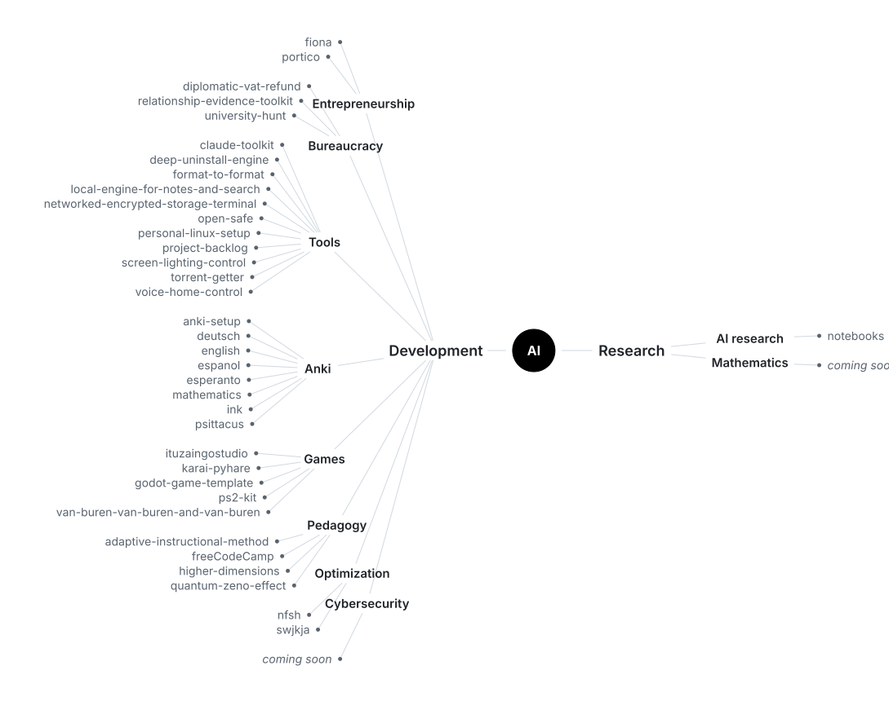

portfolio · email · linkedin

<picture>
  <source media="(prefers-color-scheme: dark)" srcset="docs/web-dark.svg">
  
</picture>

Links

<!-- links -->
| Group | Projects |
|---|---|
| **Entrepreneurship** | fiona · portico |
| **Bureaucracy** | diplomatic-vat-refund · relationship-evidence-toolkit · university-hunt |
| **Tools** | claude-toolkit · deep-uninstall-engine · format-to-format · local-engine-for-notes-and-search · networked-encrypted-storage-terminal · open-safe · personal-linux-setup · [project-backlog](https://github.com/ntfifwyb/project-backlog) · [screen-lighting-control](https://github.com/verticillum/screen-lighting-control) · torrent-getter · voice-home-control |
| **Anki** | [anki-setup](https://github.com/prsnlanki/anki-setup) · [deutsch](https://github.com/prsnlanki/deutsch) · [english](https://github.com/prsnlanki/english) · [espanol](https://github.com/prsnlanki/espanol) · [esperanto](https://github.com/prsnlanki/esperanto) · [mathematics](https://github.com/prsnlanki/mathematics) · [ink](https://github.com/prsnlanki/ink) · [psittacus](https://github.com/prsnlanki/psittacus) |
| **Games** | [ituzaingostudio](https://github.com/ituzaingostudio) · karai-pyhare · godot-game-template · ps2-kit · van-buren-van-buren-and-van-buren |
| **Pedagogy** | adaptive-instructional-method · [freeCodeCamp](https://github.com/ntfifwyb/freeCodeCamp) · [higher-dimensions](https://github.com/instructional-pages/higher-dimensions) · [quantum-zeno-effect](https://github.com/instructional-pages/quantum-zeno-effect) |
| **Optimization** | [nfsh](https://github.com/cmprssd/nfsh) · [swjkja](https://github.com/cmprssd/swjkja) |
| **Machine Learning** | notebooks |
<!-- /links -->

